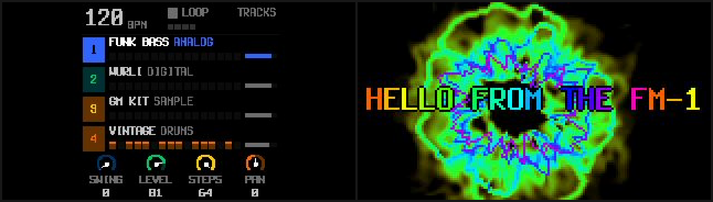

# Synthesthetic handbook

Synthesthetic turns the M-VAVE FM-1 into an audio-visual instrument. It is a four-track groovebox whose sound
drives thirty visualisers, shown on the FM-1's own screen and sent over the same USB cable as a webcam. A set can go
straight into OBS, Zoom or a video call, with no capture card and no driver. A thirty-first mode, SCREEN, streams the
FM-1's display itself, so you can share your workflow as you play.

The name joins synesthesia, aesthetic and synth.

Synthesthetic is free software under the GPL-3.0. It is built on SLOOP 2.7.1 by isod89, which is built on Felucca by
Leo Kuroshita (Hügelton Instruments), which grew from Dinghy. It is a beta: use it at your own risk.

- **Install it:** [the web installer](https://michaeljsmalley.github.io/synthesthetic/webapp/installer/), in Chrome or Edge.
- **Edit sounds, sequences and visual settings:** [the web editor](https://michaeljsmalley.github.io/synthesthetic/webapp/editor/).
- **Try it without an FM-1:** [the Play page](https://michaeljsmalley.github.io/synthesthetic/play/): the real firmware on a 3D FM-1, in the browser.
- **Source code:** [github.com/michaeljsmalley/synthesthetic](https://github.com/michaeljsmalley/synthesthetic).


## Contents

1. [What it does](#what-it-does)
2. [Install and update](#install-and-update)
3. [First steps](#first-steps)
4. [The visualiser](#the-visualiser)
5. [SCREEN: stream the display](#screen-stream-the-display)
6. [The autopilot and the attract mode](#the-autopilot-and-the-attract-mode)
7. [The webcam](#the-webcam)
8. [MIDI](#midi)
9. [The web editor and the installer page](#the-web-editor-and-the-installer-page)
10. [Play it in the browser](#play-it-in-the-browser)
11. [Questions and fixes](#questions-and-fixes)
12. [Recovery and safety](#recovery-and-safety)
13. [How it works](#how-it-works)
14. [Building and testing](#building-and-testing)
15. [Credits and licences](#credits-and-licences)

## What it does

**The instrument is SLOOP's.** Four tracks: three synths and a drum machine. Twelve synth engines, including
six-operator FM with DX7 patches, 153 sounds and 37 drum kits. You record without a click and the loop follows you;
a step sequencer adds locks and fill conditions; song sections chain into songs; 27 punch-in effects sit under the
keys. SLOOP's manual covers playing it in depth: [SLOOP's complete guide](docs/upstream-sloop/GUIDE.md).

**The visuals are Synthesthetic's own.** Thirty-one modes: classic scopes and spectra, geometric patterns, drum
shapes where a kick, a snare, a hat and a cymbal each draw their own figure, Milkdrop-style feedback warps,
demo-scene effects, and SCREEN. Nine palettes, four knobs in the spirit of the Critter & Guitari EYESY, an autopilot
that changes the picture on the bar, and a quick fade between modes.

**The webcam.** Plugged into a computer, the FM-1 is a USB camera named Synthesthetic: 320 × 180 MJPEG at 30
frames a second. The same cable carries USB-MIDI and a USB audio input, which is the FM-1's own output in 16-bit
stereo at 44.1 kHz, all at the same time. An overlay can add the tempo, the bar and a title card. The camera's
brightness, saturation, contrast and hue controls turn the visualiser's knobs.

**The web pages.** An installer, which also sets the webcam's title, and SLOOP's web editor with a VJ page for
every visual setting.

## Install and update

**What you need:** an FM-1, a USB data cable plugged straight into the computer (no hub), and Chrome or Edge on a
computer or an Android phone. Those browsers have Web MIDI, which the installer uses. Close any other app that uses
MIDI first, including other browser tabs with the editor open.

1. Open [the installer page](https://michaeljsmalley.github.io/synthesthetic/webapp/installer/).
2. Press **INSTALL** and allow MIDI access when the browser asks.
3. Wait for **Done**, and do not unplug the cable while it writes. The FM-1 restarts on Synthesthetic's boot
   screen: a video signal coming on, the ring drawing itself, the name in rainbow letters.

**Which firmware you can install over.** From M-VAVE's official V15, Dinghy or SLOOP, install directly.
From any other firmware family, Baud Girl's FM-1+VA for example, go back to official V15 with M-VAVE's own
updater, M-UPGRADE, first. Installing straight over another family's flash layout is the known way to brick an FM-1.

**From a terminal**, with this repository:

```sh
python3 tools/fm1_install.py build/felucca-0.1.fwsc
```

It needs Python with `mido` and `python-rtmidi`.

**Updates keep your work.** Projects, settings, presets, kits and samples live in a part of the flash that an update
never writes. A pattern you recorded under SLOOP is still there after you install Synthesthetic, and after every
Synthesthetic update. To start clean, make a NEW project or erase the sections (SAVE > PROJECT > ERASE).

**Back up first.** Before your first custom firmware, take a full backup of the flash. It is the one thing that can
put an FM-1 back exactly as it was.

- **On a Mac:** put the FM-1 into its download mode with the stock soft key (`tools/fm1_softkey.py` sends it), then
  read the whole 1 MiB with [M-Flasher](https://github.com/jvitkauskas/m-flasher). Start M-Flasher within about half
  a minute of the FM-1 entering download mode, or it drops out. Do not install M-Flasher's optional m-bootloader:
  every recovery tool expects M-VAVE's own boot code.
- **On Windows or Linux:** [MvaveFM1Unbricker](https://github.com/Quixotic7/MvaveFM1Unbricker) and
  [jl-uboot-tool](https://github.com/kagaimiq/jl-uboot-tool) read and write the flash in the same mode.

**Going back to official V15.** The installer page's last section does it, with the unmodified FM-1.fwsc from
M-VAVE's V15 download. Save a backup with the editor first (Projects, then Backup): the official firmware cannot open
Synthesthetic's projects. M-UPGRADE works too.

## First steps

- **There is no factory song.** PLAY does nothing until something is recorded. The quickest beat: turn ALGORITHM to
  track 4 (orange, the drums), press REC, play a beat on the white keys, and press REC again on the "1" after your
  last bar. The loop closes, sets the tempo and plays. SLOOP's guide has the full "first beat in 60 seconds".
- **The menu:** hold HOME for about a second. It has SCREEN, LIGHTS, AUDIO, SYSTEM and Synthesthetic's VJ section.
  SYSTEM > ABOUT shows the version, and "2 CORES" when the second core runs: that core draws the video.
- **The visualiser:** on the TRACKS screen, tap HOME. Tap it again to close it.

## The visualiser

The visualiser shows the mode's name and number above the picture, AUTO in amber when the autopilot runs, and the
four knobs' values below. HOME, or any page button, closes it. The keys, PLAY, REC and the layers work as usual.

| Control | Does |
| --- | --- |
| **SELECT** | the next or previous mode (31) |
| **PRESETS** | the palette: SPECTRUM, NEON, FIRE, OCEAN, CRT, VAPOR, ACID, THERMAL, MONO |
| **ALGORITHM** | the autopilot: OFF, or a new picture every 4, 8, 16 or 32 bars |
| **KNOB 1 AMOUNT** | size, scale, strength or count, depending on the mode |
| **KNOB 2 RATE** | speed, rotation, and the palette's cycling |
| **KNOB 3 TRAILS** | 0: none; higher: longer trails; full: the picture nearly persists |
| **KNOB 4 COLOR** | the hue, or where the palette starts |

All of it is kept with the settings, through power-off and firmware updates. A mode change fades: the old picture
goes dark in four frames and the new one comes up in five, about a third of a second in all.


### The modes

| # | Mode | Shows |
| --- | --- | --- |
| 1 | **WAVE** | the mix's waveform, left and right, standing still |
| 2 | **BARS** | 32 bands, a quarter octave each from 40 Hz to 10 kHz, in decibels, with falling caps |
| 3 | **HEAT** | the spectrum scrolling by, cold to hot |
| 4 | **XY** | left against right: the stereo image |
| 5 | **METERS** | tracks 1 to 4 and the mix in decibels, with peak holds |
| 6 | **RING** | the wave round a ring, around a disc that swells with the bass |
| 7 | **SPIRAL** | the wave along a spiral from the centre |
| 8 | **GRID** | forty circles, each a point of the wave |
| 9 | **KIT** | the drums, each its own shape: the kick a disc that pops, the snare a star, the clap a scatter of blocks, the closed hat a tick, the open hat a ring that opens, a tom a triangle (low on the left, high on the right), the crash a wide ring with sparks, the ride a small ring, percussion a diamond |
| 10 | **TUNNEL** | squares receding, pumped by the mix and the kick |
| 11 | **MIRROR** | the waves mirrored four ways |
| 12 | **STARS** | a starfield flying at you, the bass on the throttle |
| 13 | **SQUARES** | a square for every synth note, in its track's colour, and the drums as in KIT |
| 14 | **SHARDS** | triangles flung out by the synth notes, and the drums as in KIT |
| 15 | **ORBITS** | a dot per band, each on its own orbit |
| 16 | **MOIRE** | an XOR moiré that races with the level |
| 17 | **WARP** | the classic feedback: the picture zooms and turns, the wave round a ring feeds it, the kick pushes it |
| 18 | **VORTEX** | a whirlpool, strongest at the centre, with the bands as sparks |
| 19 | **RIPPLE** | rings of zoom running out from the centre, the wave across them |
| 20 | **KALEIDO** | the picture folded into 4, 6 or 8 mirrored wedges, turning |
| 21 | **MELT** | everything drips down, wobbling, fed by the spectrum along the top |
| 22 | **SMOKE** | everything rises and curls, the wave along the bottom the fire under it |
| 23 | **WORMHOLE** | a wandering hole pulling the picture round and in |
| 24 | **PLASMA** | four waves added together, the colours cycling through them |
| 25 | **FIRE** | heat rising from the bottom, fed by the bands, flaring on the kick |
| 26 | **RIDGES** | the last seconds of the spectrum as a mountain range |
| 27 | **LAVA** | four blobs that swell with their bands and melt into each other |
| 28 | **CELLS** | cells round eight drifting seeds, with bright edges, shaken by the kick |
| 29 | **WIREFRAME** | a cube, an octahedron, an icosahedron or a tesseract turning, its trails behind it |
| 30 | **FRESNEL** | two zone plates wandering through each other |
| 31 | **SCREEN** | not a picture: the FM-1's own display, to stream your workflow |

Modes 17 to 30 are procedural: they draw in intensities, and the palette maps those to colours, cycling as they
play. The spectrum is a true decibel display: full height is 0 dBFS, each tenth of the height is 6 dB, and the floor
is -60 dB. The visuals listen to the mix before the MASTER knob, so the volume does not change the picture.

## SCREEN: stream the display

With SCREEN chosen, the webcam shows the FM-1's display exactly as it is: every page, layer and menu you open. It
appears at three-quarter size, 180 × 180, in the middle of the picture with black either side, and with no overlay
and no effects. On the visualiser itself you see a card saying so; open any page and you are streaming your
workflow, which suits tutorials and live sets alike. The autopilot and the attract mode leave SCREEN alone, and it
fades in and out like any other mode.



## The autopilot and the attract mode

**The autopilot** (ALGORITHM on the visualiser, or menu VJ > AUTOPILOT): every 4, 8, 16 or 32 bars, on the bar, it
picks a new mode with a variation of its own (a direction, a fold count, a solid) and, every other time, a new
palette. While the sequencer plays it counts the song's bars; stopped, it keeps time at the tempo. Your own mode and
palette stay in the settings, because the autopilot only changes what is shown. It never picks SCREEN, and it waits
while SCREEN is chosen. It is on by default, every 8 bars.

**The attract mode** (menu VJ > ATTRACT: OFF, 30 seconds, 1, 2 or 5 minutes; 1 minute by default): after that long
without a button, key or knob on the TRACKS screen, the visualiser opens by itself. Any button or key closes it
again and does what it normally does. It stays off while SCREEN is chosen, because then the display is what the
webcam shows.

## The webcam

The camera is called **Synthesthetic** and sends 320 × 180 MJPEG at 30 frames a second, the same picture as the
visualiser whether the screen shows it or not. Photo Booth, QuickTime, OBS, Zoom and FaceTime all see it. 16:9 suits
every app's preview, so nothing gets cropped. The MIDI port keeps the name **Felucca**, which is what installers and
editors look for.

Tested on macOS. Windows and Linux ship the same standard USB video driver, so they should work too, but they have
not been tried yet.

**What to expect from apps:**

- **Photo Booth mirrors its preview,** like a bathroom mirror, so text reads backwards there. The FM-1 sends the
  picture the right way round: OBS and QuickTime recordings show it as it is, and Zoom and FaceTime mirror only your
  own self-view, never what others see.
- **One app at a time** can use a camera. An app that grabs every camera, such as Camo Studio, blocks the FM-1 from
  the others: quit it first.
- **Microphone permission:** the FM-1 is also an audio input, so an app that records sound with the picture asks for
  microphone access. The picture alone needs only camera access.
- **ffmpeg's macOS camera input** keeps one frame at a time and loses frames above about 22 a second. The FM-1 sends
  30; OBS, QuickTime and `tools/fm1_avrate.py` show the real rate.
- **The MIDI port name:** on a Mac, Audio MIDI Setup may keep showing an older name for the FM-1 until you remove
  its entry there.

**Camera controls.** Webcam settings apps show the FM-1's four camera controls as sliders: OBS on Windows,
`v4l2-ctl` on Linux, a camera-settings app on macOS, or `tools/fm1_uvcctl.py` from a terminal. They are the
visualiser's knobs:

| Camera control | Knob |
| --- | --- |
| Brightness | AMOUNT |
| Saturation | RATE |
| Contrast | TRAILS |
| Hue | COLOR |

**The overlay** (menu VJ > OVERLAY) appears on the webcam only, never on the FM-1's screen:

- **INFO**: the tempo, the bar and beat, the mode's and palette's names for a moment when they change, and a LIVE tag
  blinking on the beat.
- **TITLE**: a title card over the picture, its letters across the spectrum, turning.
- **INFO + TITLE**: both.

The title is SYNTHESTHETIC until you set your own, up to 19 characters, kept with the settings. Three ways to set it:

- **The installer page's Webcam title section:** type a title, choose what the overlay shows, press Send. No editor
  needed.
- **The web editor's VJ page:** the title, the overlay and every other visual setting, read from the FM-1 and sent
  back.
- **A terminal:**

```sh
python3 tools/fm1_vj.py title="LIVE AT NINE" overlay=title
python3 tools/fm1_vj.py              # show every visual setting
python3 tools/fm1_vj.py --defaults   # back to the defaults
```

## MIDI

The visuals listen on their own MIDI channel, set in menu VJ > VISUALS MIDI CH (16 by default; OFF turns it off):

| Message | Does |
| --- | --- |
| CC 20, 21, 22, 23 | AMOUNT, RATE, TRAILS, COLOR (0 to 127) |
| CC 24 | the mode (0 to 127 spread across the 31) |
| CC 25 | the palette (0 to 127 spread across the 9) |
| CC 26 | the autopilot (0 off, up to 127 for every 32 bars) |
| CC 27 | the overlay (0-31 off, 32-63 info, 64-95 title, 96-127 both) |
| Program Change n | mode n + 1 |
| a note | a beat for the picture: the shape modes and the warps take it as a kick |

Other messages on that channel carry on as before: SLOOP's REMOTE and FX CH keep their CCs and notes there if they
share the channel. Changes made over MIDI or with the camera controls count as turning the knobs, so they are kept
with the settings once the FM-1 is stopped and quiet. The autopilot's changes are not kept: your own mode and palette
come back when it stops.

## The web editor and the installer page

**The editor** is SLOOP's web editor, renamed: sounds, parameters, sequences, songs, drum kits, the drum synth,
samples, themes and full backups, all over USB-MIDI from Chrome or Edge. It works offline too: download it as one
file, or install it as an app. Synthesthetic adds the **VJ** page: the webcam's title and overlay, the autopilot,
the attract mode, the visuals' MIDI channel, the mode, the palette and the four knobs. A backup includes the visual
settings, and restoring it puts them back.

**The installer page** installs and updates Synthesthetic, sets the webcam title on a running FM-1, and takes the
FM-1 back to official V15. Before sending a title it checks that the FM-1 runs Synthesthetic with the webcam built
in, and says so if not.

## Play it in the browser

[The Play page](https://michaeljsmalley.github.io/synthesthetic/play/) runs Synthesthetic on a 3D FM-1 in the browser.
It is the firmware itself: the same C sources, compiled to WebAssembly (`firmware/host/web.c`, built by
`tools/build_web.py`), running in the page's audio thread. The engines, the sequencer, the screens, the LEDs and the
visualisers are the real ones, and the webcam's picture plays beside the FM-1 with its VJ settings.

A first visit starts with a demo song in song mode (sections and an order, as SAVE held makes them): about 80 s of
deep house at 122 BPM in A minor. Press PLAY.

| Section | Bars | What happens |
|---|---|---|
| D, intro | 4 | the drums come in under the piano's Am9, muffled by a low-pass; a noise riser sweeps up into the verse |
| A, verse | 8 | FUNK BASS with octave slides, M1 PIANO stabs over Am9, Fmaj9, Dm9 and E7, the vibes answering |
| B, chorus | 8 | the lift to Fmaj9, G6/9, Em9 and Am9: the bass in disco octaves, open hats, the VIBES hook |
| A, verse | 8 | |
| C, bridge | 4 | the breakdown on Dm9, Em9, Fmaj9 and E7: a WARM PAD and a SUB BASS held, no kick, then a snare build |
| B, chorus | 8 | from the bridge's E7 to the chorus's F, then round again from the intro |

STOP leaves the verse as a loop to play over; SAVE held shows the song (keys 1 to 4 its sections, key 13 SONG or
LOOP). The page remembers song mode across visits.

Play it with the mouse or a touch screen (right-click a button, or hold it on a touch screen, to keep it held while
you play keys), with the computer keyboard, or with a MIDI keyboard:

| Keys | What they do |
|---|---|
| `Z` to `,` and `S` `D` `F` `H` `J` `L` | F3 to F4 (white keys 1 to 8, the first eight steps) |
| `Q` to `I` and `2` `3` `5` `6` `8` | G4 to G5 (white keys 9 to 16) |
| `Space`, `Enter`, `Esc` | PLAY, REC, HOME |
| `Shift`, `A`, `G` | SEQ, ARP, GLO (held) |
| `←` `→`, `↑` `↓`, `[` `]` | OCT− and OCT+, SELECT, PRESETS |

A MIDI keyboard plays the selected track, as the FM-1's own keys do; a switch sends it by channel instead, as the
FM-1 takes MIDI over USB. Projects, presets and settings stay in the browser (IndexedDB) between visits; Start over
erases them. What it cannot do: USB. The page shows the webcam picture instead of sending it, the editor and the
installer cannot reach this FM-1, and user samples and firmware updates need a real one. The 3D model is adapted
from [FM1.quest](https://github.com/hericdk/fm1-quest) by hericdk (GPL-3.0).

## Questions and fixes

**PLAY makes no sound.** There is no factory song: record a pattern first (see [First steps](#first-steps)).

**My old beat is still there after updating.** By design: updates never touch your projects. Make a NEW project or
use SAVE > PROJECT > ERASE to start clean.

**The camera doesn't show up.** Check that the FM-1 is switched on and connected with a data cable, straight to the
computer. Quit apps that grab every camera, such as Camo Studio, then unplug and replug the FM-1.

**The picture is mirrored.** That is the app's preview; see [the webcam](#the-webcam).

**The webcam looks choppy in ffmpeg.** That is ffmpeg's camera input on macOS. Check the rate in OBS or QuickTime.

**The installer can't find the FM-1.** Use a data cable (some cables only charge), plug it straight in without a
hub, and close every other app or browser tab that uses MIDI.

**Holding OCT- while switching on does nothing.** On M-VAVE's official firmware, and on some other firmwares, that
is normal: they have no key-held rescue. On Synthesthetic, hold OCT- alone before you switch on: the USB rescue
opens (its screen still reads SLOOP USB RESCUE, because Synthesthetic keeps SLOOP's rescue updater unchanged), and
the installer works from there. Early Dinghy builds missed the key on some units because the keys were read before
the screen's pins were set up; Synthesthetic carries the fix.

**The visualiser says NO VIDEO CORE, or the webcam shows a test card.** The video core is stopped: an update was
started and did not finish, or the firmware was built without the webcam. Switch the FM-1 off and on.

**The webcam title doesn't show.** The overlay must be TITLE or INFO + TITLE, and SCREEN shows no overlay at all.

## Recovery and safety

A software problem on an FM-1 is almost always recoverable, because each of these steps works when the one before
it does not:

1. **The USB rescue:** hold OCT- while switching on. Only the updater runs, with no audio; install again from the
   browser or with `tools/fm1_install.py`. Two crashes in a row at start-up open it by themselves.
2. **The update mode:** hold OCT- and OCT+ together for 5 seconds while stopped (a countdown shows from 2 seconds),
   or send the soft key SysEx `F0 22 24 35 7D F7`. The chip's own ROM takes over, a mode no flash write can erase.
   M-Flasher, MvaveFM1Unbricker and jl-uboot-tool can then read and write the whole flash.
3. **The hard case:** if the firmware dies before it can do either, for example after a write interrupted by a flat
   battery, the [FM-1 Transporter](https://github.com/kurogedelic/FM-1-transporter), a small RP2040 dongle, forces
   the ROM mode through the USB-C port. No need to open the case.

What bricks an FM-1, and how to avoid it:

- Installing one custom firmware straight over another family's flash layout: always go back to official V15
  between families.
- Overclocking: Synthesthetic keeps the chip at its standard 240 MHz.
- Losing power in the middle of a write: charge the battery before installing.
- Writing the first 16 KB of the flash, which hold the boot code: nothing recovers that over USB. No installer or
  tool in this project writes there.
- Trusting another firmware's saved data: Synthesthetic checks its own markers and starts fresh when they are
  missing.

## How it works

This section is for the curious; nothing in it is needed to play.

### The hardware

| Part | What it is |
| --- | --- |
| Chip | JieLi AC7911B: two 32-bit pi32v2 cores at 240 MHz, no floating point unit |
| Memory | about 450 KB of on-chip RAM, 1 MiB of flash |
| Screen | 240 × 240 ST7789 on SPI, run at 30 MHz by Synthesthetic (SLOOP: 12 MHz) |
| USB | full speed (12 Mbit/s) only, five endpoints |
| Controls | 27 keys, 14 lit buttons, 7 encoders, the MASTER pot; TRS MIDI in |

Full speed USB is why the webcam sends MJPEG: uncompressed video at this size would manage about 9 frames a second.
Every computer's camera stack accepts MJPEG from a full-speed camera.

### Two cores

The first core runs the instrument: the audio, the sequencer, the screen and USB. The second core runs one long job,
frame after frame: draw the picture, encode it as a JPEG, publish it. They share state through small mailboxes, each
written by one core only, so neither can overwrite the other's updates.

The flash holds the code, and both cores run from it. When the first core writes the flash, for an autosave for
example, the flash is briefly unreadable, so the second core first parks itself in a loop that runs from RAM and
waits there until the write is done. A long soak test, with autosaves under a running webcam, has never seen a park
fail.

### The picture

- **The frame** is 160 × 90 pixels of palette indices, a byte each. Every frame builds its own 256-colour palette,
  once as YCbCr for the JPEG and once as RGB565 for the screen, which makes colour cycling and fades nearly free.
  The webcam gets the frame doubled to 320 × 180; the FM-1's screen shows it 1.5 times as large.
- **The analyser** reads the mix at 22 kHz, before MASTER: a 1024-point FFT, 32 bands of about a quarter octave from
  40 Hz to 10 kHz, measured in decibels. Note-ons per track, the drum hits by family, the tracks' levels and the beat
  come straight from the sequencer.
- **The warp engine** behind WARP, VORTEX, RIPPLE, KALEIDO, MELT, SMOKE and WORMHOLE works the way Milkdrop does: a
  mesh of 11 × 13 points says where each part of the last frame moves (zoom, rotation, swirl, ripple, drift,
  kaleidoscope folds), the frame is resampled through it with bilinear blending, and TRAILS sets how fast it fades.
- **The fade** dims the palette rather than the pixels, so it costs nothing.

### The JPEG encoder

The chip has a JPEG block, but its driver is closed, so Synthesthetic encodes in software with integers only:
baseline JPEG, 4:2:0 colour, the standard tables. Because the doubled frame repeats every pixel 2 × 2, the encoder
folds the DCT's equal halves together and does about a quarter of the work, with output identical to the full
transform. Blocks of a single colour skip the transform altogether. The quality follows the size: it rises while
frames stay under half of the 16 KB buffer and drops when one overflows. Encoding takes 18 to 25 ms a frame, which
leaves room for 30 frames a second on every mode.

### USB

The FM-1 is one composite device: USB-MIDI on endpoint 1, the audio input on endpoint 3 and the video on endpoint 4.
Video goes out in isochronous packets of 1016 bytes, one per millisecond, a new frame every 33 ms timed by the clock.
A camera app that closes in the middle of a frame releases it, so the video core never waits on a frame nobody is
reading. The camera's four controls come from a standard UVC processing unit.

### SCREEN

While SCREEN is on, every drawing the FM-1 sends to its screen also lands in a 180 × 180 copy, one byte a pixel. Of
every four columns, two keep their own column and two share one, and the same for rows; where two pixels share, the
one that stands out more from the background wins, so thin lines and text strokes survive the shrink. Which pairs
share was chosen by measuring where the interface's drawings actually start and end, so one drawing almost never
splits a pair. Colours go through a 256-colour palette of 216 colours and 40 greys, with black and white exact. The
copy uses the same RAM as the picture frames, so SCREEN costs almost no extra memory. The second core places it in
the middle of the 320 × 180 picture and encodes it like any frame.

### Settings

Your visual settings sit in the settings' side record in flash, next to SLOOP's own, so older firmware simply ignores
them. The web editor reads and writes them as backup object 12 of the editor protocol, version 13; see
`web/EDITOR_PROTOCOL.md`.

## Building and testing

You only need this to change the firmware.

**The toolchain** is JieLi's pi32v2 clang, which runs on Linux x86-64; on a Mac, the build runs each tool in a
linux/amd64 Docker container. The three files it needs from JieLi's AC79 SDK are in `vendor/ac79-sdk-min`. JieLi's
download server can be slow or unreachable from some networks; resume the download with `curl -C -`.

```sh
# the firmware with the webcam (a plain build.sh makes the audio-only build)
AC79_SDK=$PWD/vendor/ac79-sdk-min JIELI_TOOLCHAIN=$HOME/.jieli/toolchain FELUCCA_UVC=1 sh build.sh
# a release: identity FM-1_951, version SYNTHESTHETIC 0.1 BETA, build/felucca-0.1.fwsc
FELUCCA_UVC=1 sh build.sh --release 0.1
# the firmware for the browser (the Play page): Emscripten, or clang with wasm-ld
python3 tools/build_web.py --release 0.1
# the tests: the instrument, the video modules, the web pages, the firmware in the browser
sh tests/run_tests.sh
sh tests/run_video_tests.sh
node web/test_web.mjs
node tests/web_test.mjs
# the site in docs/, from a package
python3 web/make_site.py build/felucca-0.1.fwsc 0.1 docs
```

The host tests run the real firmware code on the computer: the UI on a framebuffer, the audio engines against golden
renders, the JPEG encoder against libjpeg, every visual mode against a synthetic mix, the USB video function's
descriptors and packets, and the web pages against a simulated FM-1. `tests/web_test.mjs` boots the browser build
through its boot screen, plays it, films every mode and keeps a project across a reload.

**Tools** in `tools/`:

| Tool | Does |
| --- | --- |
| `build_web.py` | compiles the firmware for the browser (`firmware/host/web.c`): the Play page's `synthesthetic.wasm` |
| `fm1_install.py` | installs a package over USB-MIDI; `--info` shows what the FM-1 runs |
| `fm1_vj.py` | reads and sets every visual setting |
| `fm1_title.py` | sets the webcam title and the overlay |
| `fm1_uvcctl.py` | reads and sets the camera controls |
| `fm1_vcdiag.py` | the video core's counters; `stop`, `start`, `style N` |
| `fm1_capture.py` | captures the webcam while playing notes, with a contact sheet |
| `fm1_avrate.py` | the frame rate macOS actually delivers |
| `fm1_soak.py` | a long test on the unit: autosaves under a running webcam |
| `fm1_softkey.py` | sends the soft key that opens the ROM download mode |

**Rules the build enforces**, inherited from Dinghy: no floating point, no 64-bit division, no calls into the chip's
ROM, hardware registers touched only in `firmware/hal/`, RAM within budget. And the project's own:

- Never write the first 16 KB of the flash.
- Keep the update and rescue paths intact, and test the OCT- rescue after any USB change.
- Compare the package's hash before installing: a failed build leaves the previous package in place.
- Feed the watchdog: the main loop must come round at least every 8 seconds.

**More reading:** `UPSTREAM.md` lists what differs from SLOOP, file by file; `web/EDITOR_PROTOCOL.md` documents the
editor's SysEx protocol.

## Credits and licences

Synthesthetic is free software under the GNU General Public License version 3 only; see `LICENSE` and
`LICENSING.md`. It stands on the work of many people:

- [SLOOP](https://github.com/isod89/sloop-fm1) by isod89: the instrument, the editor, the installer. SLOOP's dual-core
  audio comes from Andre Rezemini's dual-core branch.
- [Felucca](https://github.com/hugelton/Felucca) by Leo Kuroshita (@kurogedelic), Hügelton Instruments: the platform,
  the engines and the update path.
- [Dinghy](https://github.com/zvenson/dinghy) by zvenson: the bare-metal starting point and its safety rules.
- [FM1.quest](https://github.com/hericdk/fm1-quest) by hericdk: the 3D FM-1 the Play page adapts (GPL-3.0), and with
  sabliran's [sloop-web-emu](https://github.com/sabliran/sloop-web-emu), the idea of the firmware in a page.
- [three.js](https://threejs.org) (MIT) draws the 3D FM-1.
- msfa by Google and Pascal Gauthier, from Dexed: the FM6 engine (Apache-2.0).
- The Terminus font by Dimitar Toshkov Zhekov (SIL OFL 1.1), and the Fukiai icon font by Hügelton Instruments (MIT).
- Samples from Versilian Studios' VSCO-2 Community Edition and VCSL, and from Sonic Pi (CC0); the PERC set from
  Felucca's own drum sounds (the Hügelton Sample Pack, Hügelton Instruments: see `LICENSING.md`).
- Three files of JieLi's AC79 SDK, under the Apache License 2.0, in `vendor/ac79-sdk-min`.
- The community's research and tools: [FM-1-RE](https://github.com/AL-255/FM-1-RE),
  [the FM-1 resource hub](https://github.com/aroum/fm1-custom-fw), [M-Flasher](https://github.com/jvitkauskas/m-flasher),
  [MvaveFM1Unbricker](https://github.com/Quixotic7/MvaveFM1Unbricker), [jl-uboot-tool](https://github.com/kagaimiq/jl-uboot-tool),
  [the FM-1 Transporter](https://github.com/kurogedelic/FM-1-transporter) and
  [fm1-emu](https://github.com/joakimeriksson/fm1-emu).
- The idea of an instrument with its own video synthesizer comes from Critter & Guitari's EYESY.

M-VAVE and FM-1 are trademarks of their respective owners. Synthesthetic is not affiliated with M-VAVE or with
Critter & Guitari.
