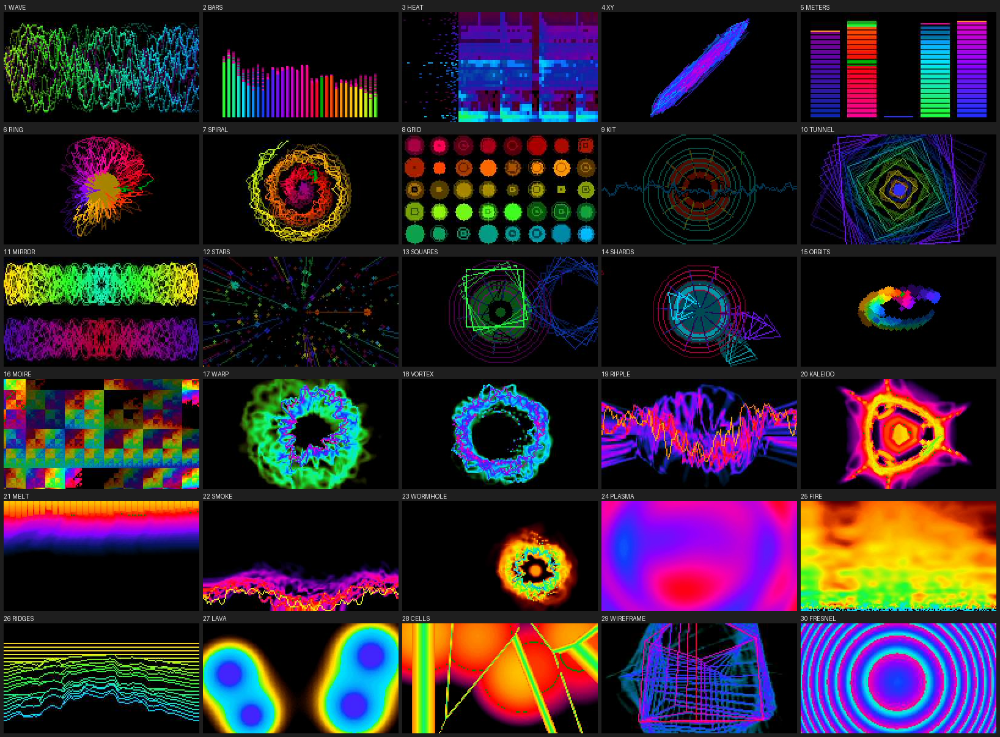
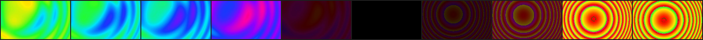
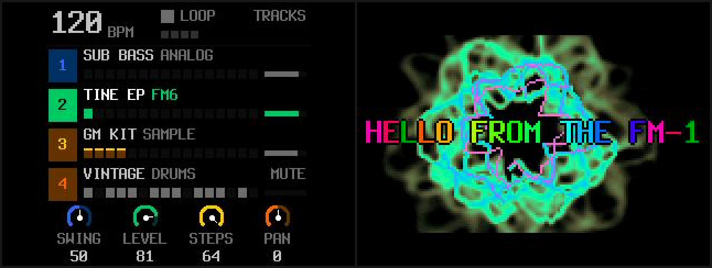

# Synthesthetic handbook

Synthesthetic turns the M-VAVE FM-1 into an audio/video synth. It's the first FM-1 firmware that sends video to a
computer over USB. Plug your FM-1 in, choose it from the camera list in OBS, Zoom, FaceTime or another video app, and
you'll see 30 visualizers that react to your music. There's no camera in the FM-1. It's in that list because a USB
camera is the standard way to get video onto a computer, so you don't need a driver or capture card. The FM-1 is still
the same four-track groovebox.

The name comes from synesthesia, aesthetic and synth.

Synthesthetic is free software under the GPL-3.0, built on SLOOP 2.7.1 by isod89 and Felucca by Leo Kuroshita of
Hügelton Instruments. This is a beta, so use it at your own risk.

- Install it with [the web installer](https://michaeljsmalley.github.io/synthesthetic/webapp/installer/) in Chrome or Edge.
- Edit sounds, patterns and visual settings in [the web editor](https://michaeljsmalley.github.io/synthesthetic/webapp/editor/).
- Try it without an FM-1 on [the Play page](https://michaeljsmalley.github.io/synthesthetic/play/), which runs the firmware in your browser.
- Download releases and read the source code at [github.com/michaeljsmalley/synthesthetic](https://github.com/michaeljsmalley/synthesthetic).
- Build it yourself, or see how it works inside, with [DEVELOPMENT.md](DEVELOPMENT.md).



## Contents

1. [What it does](#what-it-does)
2. [Install and update](#install-and-update)
3. [First steps](#first-steps)
4. [The visualizer](#the-visualizer)
5. [SCREEN mode](#screen-mode)
6. [Autopilot and attract mode](#autopilot-and-attract-mode)
7. [USB video](#usb-video)
8. [MIDI](#midi)
9. [The web editor and installer](#the-web-editor-and-installer)
10. [Play in the browser](#play-in-the-browser)
11. [Troubleshooting](#troubleshooting)
12. [Recovery and safety](#recovery-and-safety)
13. [Credits and licenses](#credits-and-licenses)

## What it does

The instrument comes from SLOOP. It has four tracks, three synths and a drum machine, with 12 synth engines
(including six-operator FM that loads DX7 patches), 153 sounds, 37 drum kits, a step sequencer with parameter locks,
song sections and 27 punch-in effects. [SLOOP's guide](docs/upstream-sloop/GUIDE.md) covers it in detail.

The visuals are new in Synthesthetic. There are 31 modes, nine palettes, four knobs modeled on the Critter & Guitari
EYESY, an autopilot that changes the picture on the bar, and a short fade between modes.

Over USB, the FM-1 shows up as a camera called Synthesthetic that sends 320 × 240 MJPEG at 30 frames per second. The
same cable carries USB-MIDI and a USB audio input with the FM-1's output (16-bit stereo at 44.1 kHz).

## Install and update

You need an FM-1, a USB data cable plugged directly into the computer (no hub), and Chrome or Edge on a computer or
an Android phone. The installer uses Web MIDI, which those browsers support. Before you start, close any other app
that uses MIDI, including browser tabs with the editor open.

1. Open [the installer](https://michaeljsmalley.github.io/synthesthetic/webapp/installer/).
2. Press INSTALL and allow MIDI access when the browser asks.
3. Wait until it says Done, and don't unplug the cable while it's writing. The FM-1 then restarts into
   Synthesthetic's boot screen.

### Which firmware you can install over

You can install directly over M-VAVE's official V15, Dinghy or SLOOP. If your FM-1 runs anything else, such as Baud
Girl's FM-1+VA, go back to official V15 first with M-VAVE's own updater, M-UPGRADE. Installing over a different
firmware family's flash layout is the most common way FM-1s get bricked.

### Installing from a terminal

Download the `.fwsc` file from the [releases page](https://github.com/michaeljsmalley/synthesthetic/releases), or
build it yourself, then run:

```sh
python3 tools/fm1_install.py synthesthetic-0.2.fwsc
```

This needs Python with `mido` and `python-rtmidi` installed.

### Updates keep your work

Projects, settings, presets, kits and samples live in a part of the flash that updates never touch. Patterns you
recorded under SLOOP are still there after you install Synthesthetic, and after every Synthesthetic update. To start
from scratch, make a NEW project or erase the sections with SAVE > PROJECT > ERASE.

### Back up first

Before you install any custom firmware for the first time, make a full backup of the flash. It's the only way to put
an FM-1 back exactly as it was.

- On a Mac, put the FM-1 into download mode with the stock soft key (`tools/fm1_softkey.py` sends it), then read the
  whole 1 MiB with [M-Flasher](https://github.com/jvitkauskas/m-flasher). Start M-Flasher within about 30 seconds of
  the FM-1 entering download mode, or it drops out. Don't install M-Flasher's optional m-bootloader, because every
  recovery tool expects M-VAVE's own boot code.
- On Windows or Linux, [MvaveFM1Unbricker](https://github.com/Quixotic7/MvaveFM1Unbricker) and
  [jl-uboot-tool](https://github.com/kagaimiq/jl-uboot-tool) can read and write the flash in the same mode.

### Going back to official V15

Use the last section of the installer page, with the unmodified FM-1.fwsc from M-VAVE's V15 download. Save a backup
in the editor first (Projects, then Backup), because the official firmware can't open Synthesthetic projects.
M-UPGRADE works too.

## First steps

There's no factory song, so PLAY does nothing until you've recorded something. For a quick beat, turn ALGORITHM to
track 4 (orange, the drums), press REC, play a beat on the white keys, and press REC again on the first beat after
your last bar. The loop closes, sets the tempo and starts playing. SLOOP's guide walks through this in more detail.

Hold HOME for about a second to open the menu. It has SCREEN, LIGHTS, AUDIO, SYSTEM and Synthesthetic's VJ section.
SYSTEM > ABOUT shows the version, and "2 CORES" when the second core is running. That's the core that draws the
video. SYSTEM > RESET starts the FM-1 over, as [Recovery and safety](#recovery-and-safety) describes.

To open the visualizer, tap HOME on the TRACKS screen. Tap it again to close it.

## The visualizer

The visualizer shows the mode's name and number above the picture and the four knob values below it. AUTO appears in
amber while the autopilot is running. HOME or any page button closes it, and the keys, PLAY, REC and the layers keep
working as usual.

| Control | What it does |
| --- | --- |
| **SELECT** | Picks the next or previous mode (31 in all) |
| **PRESETS** | Picks the palette (SPECTRUM, NEON, FIRE, OCEAN, CRT, VAPOR, ACID, THERMAL or MONO) |
| **ALGORITHM** | Turns the autopilot off, or sets it to change the picture every 4, 8, 16 or 32 bars |
| **KNOB 1 AMOUNT** | Size, scale, strength or count, depending on the mode |
| **KNOB 2 RATE** | Speed, rotation and how fast the palette cycles |
| **KNOB 3 TRAILS** | How long trails last, from none to almost permanent |
| **KNOB 4 COLOR** | The hue, or where the palette starts |

Your settings are saved and survive power-off and firmware updates. A mode change fades over about a third of a
second.



### The modes

| # | Mode | What it shows |
| --- | --- | --- |
| 1 | **WAVE** | The waveform of the mix, left and right, held steady |
| 2 | **BARS** | 32 bands from 40 Hz to 10 kHz, about a quarter octave each, in decibels, with falling peak caps |
| 3 | **HEAT** | The spectrum scrolling past, from cold colors to hot |
| 4 | **XY** | The left channel plotted against the right, showing the stereo image |
| 5 | **METERS** | Levels for tracks 1 to 4 and the mix, with peak hold |
| 6 | **RING** | The waveform wrapped around a ring, with a disc in the middle that swells with the bass |
| 7 | **SPIRAL** | The waveform drawn along a spiral from the center |
| 8 | **GRID** | Forty circles, each one a point on the waveform |
| 9 | **KIT** | Each drum as its own shape. The kick is a disc that pops, the snare a star, the clap a scatter of blocks, the closed hat a tick, the open hat a ring that opens, the toms triangles (low on the left, high on the right), the crash a wide ring with sparks, the ride a small ring, and other percussion a diamond |
| 10 | **TUNNEL** | Squares receding into the distance, pushed by the mix and the kick |
| 11 | **MIRROR** | The waveforms mirrored four ways |
| 12 | **STARS** | A starfield flying toward you, faster with more bass |
| 13 | **SQUARES** | A square for each synth note in its track's color, plus the drum shapes from KIT |
| 14 | **SHARDS** | Triangles thrown out by synth notes, plus the drum shapes from KIT |
| 15 | **ORBITS** | One dot per band, each on its own orbit |
| 16 | **MOIRE** | An XOR moiré pattern that speeds up with the level |
| 17 | **WARP** | Classic video feedback. The picture zooms and turns, fed by the waveform on a ring and pushed by the kick |
| 18 | **VORTEX** | A whirlpool, strongest at the center, with sparks from the bands |
| 19 | **RIPPLE** | Rings of zoom spreading out from the center, with the waveform across them |
| 20 | **KALEIDO** | The picture folded into 4, 6 or 8 mirrored wedges that slowly turn |
| 21 | **MELT** | Everything drips down and wobbles, fed by the spectrum along the top |
| 22 | **SMOKE** | Everything rises and curls, fed by the waveform along the bottom |
| 23 | **WORMHOLE** | A wandering hole that pulls the picture around and in |
| 24 | **PLASMA** | Four waves added together, with the colors cycling through them |
| 25 | **FIRE** | Flames rising from the bottom, fed by the bands and flaring on the kick |
| 26 | **RIDGES** | The last few seconds of the spectrum, drawn as a mountain range |
| 27 | **LAVA** | Four blobs that swell with their bands and merge into each other |
| 28 | **CELLS** | Cells around eight drifting points, with bright edges, shaken by the kick |
| 29 | **WIREFRAME** | A rotating cube, octahedron, icosahedron or tesseract that leaves trails |
| 30 | **FRESNEL** | Two zone plates drifting through each other |
| 31 | **SCREEN** | The FM-1's own display instead of a picture, for streaming how you work |

The visuals listen to the mix before the MASTER knob, so turning the volume down doesn't change the picture. The
spectrum modes measure in decibels, from 0 dBFS at full height down to -60 dB at the bottom.

## SCREEN mode

With SCREEN selected, the video shows the FM-1's display as it looks, including every page, layer and menu you
open. It appears pixel for pixel (240 × 240) in the middle of the frame, with no overlay or effects, which works
well for tutorials or for showing how you work during a set. The autopilot and attract mode never switch to or away
from SCREEN.



## Autopilot and attract mode

### Autopilot

Turn ALGORITHM on the visualizer to set it, or go to VJ > AUTOPILOT in the menu. Every 4, 8, 16 or 32 bars, right on
the bar, it picks a new mode with its own variation, and every other time a new palette too. When the sequencer is
stopped it keeps time at the current tempo. Your own mode and palette stay saved. It's on by default, every 8 bars.

### Attract mode

Set it under VJ > ATTRACT in the menu to off, 30 seconds, or 1, 2 or 5 minutes (the default is 1 minute). If you
leave the TRACKS screen that long without touching anything, the visualizer opens by itself. Any button or key closes
it again and does its normal job.

## USB video

The FM-1 has no camera, but it sends its video the way a USB camera does, using the standard USB video class (UVC).
Every computer and video app already supports UVC, so the FM-1 appears in their camera lists with no driver or
capture card. In those lists it's called Synthesthetic.

It sends 320 × 240 MJPEG at 30 frames per second, the same picture as the visualizer, whether or not the visualizer
is open on the screen. Photo Booth, QuickTime, OBS, Zoom and FaceTime all recognize it. The frame is 4:3 so that
SCREEN mode can show the display pixel for pixel, and the visualizers, which are 16:9, have a black band above and
below. The MIDI port is still called Felucca, because that's the name installers and editors look for.

It has only been tested on macOS so far. Windows and Linux use the same standard USB video driver, so they should
work, but nobody has tried them yet.

### Things to know about video apps

- Photo Booth mirrors its preview, so text looks backwards there. The FM-1 sends the picture the right way around.
  OBS and QuickTime recordings aren't mirrored, and Zoom and FaceTime only mirror your own self-view, not what other
  people see.
- Only one app can use a camera at a time. Apps that take every camera, such as Camo Studio, keep the FM-1 from the
  others, so quit them first.
- Some apps crop a camera's picture to fill a wide window, which cuts off the top and bottom of SCREEN mode. Look for a
  setting that keeps the camera's original shape, such as Original ratio in Zoom's video settings.
- The FM-1 is also an audio input, so apps that record sound with the video will ask for microphone access. Video
  on its own only needs camera access.
- ffmpeg's camera input on macOS holds one frame at a time and drops frames above about 22 per second. The FM-1
  sends 30. Use OBS, QuickTime or `tools/fm1_avrate.py` to see the real frame rate.
- On a Mac, Audio MIDI Setup can keep showing an old name for the FM-1 until you remove its entry.

### Camera controls

Any app that adjusts a camera shows the FM-1's four camera controls as sliders. You can use OBS on Windows, `v4l2-ctl` on Linux,
a camera settings app on macOS, or `tools/fm1_uvcctl.py` from a terminal. Each control turns one of the visualizer's
knobs.

| Camera control | Knob |
| --- | --- |
| Brightness | AMOUNT |
| Saturation | RATE |
| Contrast | TRAILS |
| Hue | COLOR |

### The overlay

The overlay appears in the video only, never on the FM-1's screen. Set it under VJ > OVERLAY in the menu.

- INFO shows the tempo, the bar and beat, the mode and palette names for a moment when they change, and a LIVE tag
  that blinks on the beat.
- TITLE shows a title over the picture in rainbow letters that slowly shift color.
- INFO + TITLE shows both.

The title is SYNTHESTHETIC until you change it. It can be up to 19 characters long and is saved with your settings.
You can set it in three ways.

- On the installer page, in the Title overlay section. Type a title, choose what the overlay shows and press Send.
  You don't need the editor for this.
- On the web editor's VJ page, which reads the title, the overlay and every other visual setting from the FM-1 and
  sends your changes back.
- From a terminal:

```sh
python3 tools/fm1_vj.py title="LIVE AT NINE" overlay=title
python3 tools/fm1_vj.py              # show every visual setting
python3 tools/fm1_vj.py --defaults   # go back to the defaults
```

## MIDI

The visuals listen on their own MIDI channel, which you set under VJ > VISUALS MIDI CH in the menu. It's channel 16
by default, and OFF turns it off.

| Message | What it does |
| --- | --- |
| CC 20, 21, 22, 23 | Sets AMOUNT, RATE, TRAILS and COLOR (0 to 127) |
| CC 24 | Picks the mode (0 to 127, spread across the 31 modes) |
| CC 25 | Picks the palette (0 to 127, spread across the 9 palettes) |
| CC 26 | Sets the autopilot (0 is off, up to 127 for every 32 bars) |
| CC 27 | Sets the overlay (0–31 off, 32–63 info, 64–95 title, 96–127 both) |
| Program Change n | Picks mode n + 1 |
| Any note | Counts as a beat. The shape modes and the feedback modes treat it as a kick |

Everything else on that channel works as before, so SLOOP's REMOTE and FX CH keep their CCs and notes if they share
it. Changes made over MIDI or with the camera controls are saved like turns of the knobs.

## The web editor and installer

The editor is SLOOP's web editor under a new name. It runs in Chrome or Edge, talks to the FM-1 over USB-MIDI, and
edits sounds, sequences, songs, kits, samples and themes, and makes full backups. It also works offline, as a single
downloaded file or installed as an app. Synthesthetic adds a VJ page for every visual setting, and backups include
them.

The installer page installs and updates Synthesthetic, sets the title overlay, and can take the FM-1 back to official
V15.

## Play in the browser

[The Play page](https://michaeljsmalley.github.io/synthesthetic/play/) runs Synthesthetic on a 3D model of the
FM-1. It's the actual firmware, compiled to WebAssembly, and the video it sends plays next to the model.

On your first visit, the FM-1 has a demo song loaded in song mode, about two minutes of 80s dance pop at 116 BPM in
D minor, in the spirit of Michael Jackson's records from the Thriller and Bad years. Press PLAY to hear it.

| Section | Bars | What happens |
| --- | --- | --- |
| B, chorus | 4 | The song opens on the chorus's loop, with a SYN BRASS hit on the first beat |
| A, verse | 8 | A ROUND BASS riff holds D while the DARK STR strings move from Dm9 to G9 above it, and the brass hits the end of each phrase |
| C, pre-chorus | 4 | Gm7, Am7, Bbmaj7 and A7sus4 to A7, with the bass climbing, a brass hit on every chord and the claps rolling into the chorus |
| B, chorus | 8 | Dm7, C, Bb and A7, with the TINE EP's riff and four on the floor, ending with the whole band hitting together before a tom fill |
| A, verse | 8 | |
| C, pre-chorus | 4 | |
| B, chorus | 8 | |
| D, breakdown | 8 | The bass riff under held strings, with claps and a rim pattern, then four brass hits into the last chorus |
| B, chorus | 8 | After the last chorus the song starts again from the top |

STOP brings the tracks back to the verse, so you can edit it or play along. To loop the verse instead, hold SAVE and
press white key 13 to switch from SONG to LOOP.

You can play it with a mouse or touch screen, the computer keyboard, or a MIDI keyboard. To keep a button held while
you play keys, right-click it, or press and hold it on a touch screen.

| Keys | What they do |
| --- | --- |
| `Z` to `,` plus `S` `D` `F` `H` `J` `L` | F3 to F4 (white keys 1 to 8, which also enter steps 1 to 8) |
| `Q` to `I` plus `2` `3` `5` `6` `8` | G4 to G5 (white keys 9 to 16) |
| `Space`, `Enter`, `Esc` | PLAY, REC and HOME |
| `Shift`, `A`, `G` | Hold SEQ, ARP and GLO |
| `←` `→`, `↑` `↓`, `[` `]` | OCT− and OCT+, SELECT, PRESETS |

A MIDI keyboard plays the selected track, like the FM-1's own keys. What you make is saved in your browser, and Start
over erases it. Anything that needs USB, like the editor, the installer or your own samples, needs a real FM-1.

## Troubleshooting

### PLAY makes no sound

The FM-1 doesn't come with a song. Record a pattern first, as described in [First steps](#first-steps).

### My old patterns are still there after updating

That's on purpose, because updates never touch your projects. To start clean, make a NEW project or use SAVE >
PROJECT > ERASE.

### The camera doesn't show up

Make sure the FM-1 is switched on and connected directly to the computer with a data cable. Quit apps that take
every camera, such as Camo Studio, then unplug the FM-1 and plug it back in.

### The picture is mirrored

That's the app's preview. See [Things to know about video apps](#things-to-know-about-video-apps).

### The video looks choppy in ffmpeg

That's a limit of ffmpeg's camera input on macOS. Check the frame rate in OBS or QuickTime instead.

### The installer can't find the FM-1

Use a data cable, since some cables only carry power. Plug it in directly without a hub, and close every other app
or browser tab that uses MIDI.

### Holding OCT− while switching on does nothing

On M-VAVE's official firmware and some others, that's expected, because they don't have a rescue mode you can open
with a key. On Synthesthetic, hold OCT− by itself before you switch on. The USB rescue opens, and the installer works
from there. Its screen says SYNTHESTHETIC USB RESCUE, or SLOOP USB RESCUE on Synthesthetic 0.1.
Some early Dinghy builds missed the key on certain units because they read the keys before setting up the screen's
pins. Synthesthetic includes the fix.

### The visualizer says NO VIDEO CORE, or the video shows a test card

The video core has stopped. Either an update was started and didn't finish, or the firmware was built without USB
video. Switch the FM-1 off and on again.

### The title doesn't show

Set the overlay to TITLE or INFO + TITLE. SCREEN mode never shows an overlay.

## Recovery and safety

### Starting over

SYSTEM > RESET in the menu gives the FM-1 a fresh start without reinstalling anything. Turn KNOB 3 to choose what to
reset, then press OCT+ twice within three seconds. The FM-1 restarts afterwards and keeps its hardware calibration
either way.

- SETTINGS puts every setting back the way a new FM-1 has it, including the menu, the MIDI channels, MIDI LEARN and
  the video settings. Your projects, song, kits, presets, samples, theme and favorites stay.
- EVERYTHING also erases your projects, song, kits, presets, samples, theme and favorites. Save a backup in the
  editor first (Projects, then Backup) if you might want any of it back.
- MIDI LEARN forgets the controls you've taught the FM-1, with a single press of OCT+.

### Rescue

Software problems on an FM-1 can almost always be fixed. Each of these steps still works when the one before it
can't.

1. USB rescue. Hold OCT− while switching on. Only the updater runs, with no audio, and you can install again from
   the browser or with `tools/fm1_install.py`. It also opens by itself after two crashes in a row at startup.
2. Update mode. While the FM-1 is stopped, hold OCT− and OCT+ together for 5 seconds (a countdown appears after 2
   seconds), or send the soft key SysEx `F0 22 24 35 7D F7`. The chip's own ROM takes over, and no flash write can
   damage this mode. M-Flasher, MvaveFM1Unbricker and jl-uboot-tool can then read and write the whole flash.
3. The FM-1 Transporter. If the firmware crashes before either of those can run, for example after a dead battery
   cut off a write, the [FM-1 Transporter](https://github.com/kurogedelic/FM-1-transporter) can force ROM mode
   through the USB-C port. It's a small RP2040 dongle, and you don't need to open the case.

These are the things that can brick an FM-1, and how to avoid them.

- Installing one custom firmware directly over another family's flash layout. Always go back to official V15
  between firmware families.
- Overclocking. Synthesthetic keeps the chip at its standard 240 MHz.
- Losing power in the middle of a write. Charge the battery before you install.
- Writing the first 16 KB of the flash, which holds the boot code. Nothing can recover that over USB, and no
  installer or tool in this project writes there.
- Trusting another firmware's saved data. Synthesthetic checks for its own markers and starts fresh when they're
  missing.

## Credits and licenses

Synthesthetic is free software under version 3 of the GNU General Public License only. See `LICENSE` and
`LICENSING.md` for the details. It's built on these projects and people:

- [SLOOP](https://github.com/isod89/sloop-fm1) by isod89, which provides the instrument, the editor and the
  installer. SLOOP's dual-core audio comes from Andre Rezemini's dual-core branch.
- [Felucca](https://github.com/hugelton/Felucca) by Leo Kuroshita (@kurogedelic) of Hügelton Instruments, which
  provides the platform, the engines and the update path.
- [Dinghy](https://github.com/zvenson/dinghy) by zvenson, the bare-metal starting point and its safety rules.
- [FM1.quest](https://github.com/hericdk/fm1-quest) by hericdk, whose 3D FM-1 the Play page adapts (GPL-3.0). The
  idea of running the firmware in a web page comes from FM1.quest and sabliran's
  [sloop-web-emu](https://github.com/sabliran/sloop-web-emu).
- [three.js](https://threejs.org) (MIT), which draws the 3D FM-1.
- msfa by Google and Pascal Gauthier, by way of Dexed, for the FM6 engine (Apache-2.0).
- The Terminus font by Dimitar Toshkov Zhekov (SIL OFL 1.1), the Fukiai icon font by Hügelton Instruments (MIT), and
  the website's typefaces, Archivo by Omnibus-Type and Michroma by Vernon Adams (both SIL OFL 1.1).
- Samples from Versilian Studios' VSCO-2 Community Edition and VCSL and from Sonic Pi (CC0), and Felucca's own drum
  sounds, the Hügelton Sample Pack by Hügelton Instruments, for the PERC set. See `LICENSING.md`.
- Three files from JieLi's AC79 SDK, under the Apache License 2.0, in `vendor/ac79-sdk-min`.
- Research and tools from the FM-1 community: [FM-1-RE](https://github.com/AL-255/FM-1-RE),
  [the FM-1 resource hub](https://github.com/aroum/fm1-custom-fw), [M-Flasher](https://github.com/jvitkauskas/m-flasher),
  [MvaveFM1Unbricker](https://github.com/Quixotic7/MvaveFM1Unbricker), [jl-uboot-tool](https://github.com/kagaimiq/jl-uboot-tool),
  [the FM-1 Transporter](https://github.com/kurogedelic/FM-1-transporter) and
  [fm1-emu](https://github.com/joakimeriksson/fm1-emu).
- Critter & Guitari's EYESY, which inspired the idea of a synth with its own video output.

M-VAVE and FM-1 are trademarks of their respective owners. Synthesthetic isn't affiliated with M-VAVE or with Critter
& Guitari.
