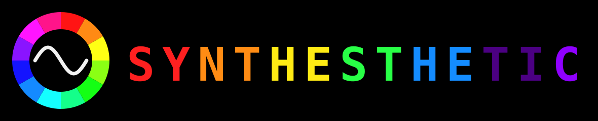

# Synthesthetic

<p align="center"></p>

Synthesthetic is custom firmware for the M-VAVE FM-1 that turns it into an audio-visual instrument. The FM-1 keeps
its synth engines, sequencer and drum machine, and gains 31 visual modes that react to the music. They show on the
FM-1's screen, and when you plug it into a computer it also works as a USB webcam (UVC, MJPEG, 320 × 180 at 30 fps),
so you can use the visuals in OBS, Zoom, Photo Booth, QuickTime or any other video app. USB-MIDI and USB audio keep
working alongside the camera, and so do firmware updates over USB-MIDI.

- Website: [michaeljsmalley.github.io/synthesthetic](https://michaeljsmalley.github.io/synthesthetic/), with the web
  installer, the web editor and the handbook.
- Releases: [the releases page](https://github.com/michaeljsmalley/synthesthetic/releases) has each version's
  firmware file and release notes.
- Try it without an FM-1: [the Play page](https://michaeljsmalley.github.io/synthesthetic/play/) runs the firmware,
  compiled to WebAssembly, on a 3D FM-1 in your browser.
- Documentation: [HANDBOOK.md](HANDBOOK.md), which is also on the website.

Synthesthetic is based on [SLOOP](https://github.com/isod89/sloop-fm1) 2.7.1 by isod89, which is based on
[Felucca](https://github.com/kurogedelic/felucca) by Leo Kuroshita of Hügelton Instruments. It's licensed under the
GPL-3.0-only (see [LICENSING.md](LICENSING.md)). The instrument itself, meaning the engines, sequencer, drums and
web editor, comes from SLOOP. The visualizers, the webcam and the video core are new in Synthesthetic.

## Features

- 31 visual modes, all drawn from the sound by the FM-1's second core. There are classic scopes and spectrum displays
  (WAVE, BARS, HEAT, XY, METERS), geometric patterns (RING, SPIRAL, GRID, TUNNEL, MIRROR, STARS, ORBITS, MOIRE),
  drum-reactive shapes (KIT, SQUARES, SHARDS), and 14 procedural modes built on a Milkdrop-style feedback engine and
  demoscene effects (WARP, VORTEX, RIPPLE, KALEIDO, MELT, SMOKE, WORMHOLE, PLASMA, FIRE, RIDGES, LAVA, CELLS,
  WIREFRAME, FRESNEL).
- SCREEN mode, which sends the FM-1's own display over the webcam so you can stream a set or a tutorial.
- Nine palettes with color cycling, and a short fade between modes.
- An autopilot that picks a new mode, variation and palette every 4, 8, 16 or 32 bars.
- Controls modeled on the Critter & Guitari EYESY. SELECT picks the mode, PRESETS the palette and ALGORITHM the
  autopilot, and knobs 1 to 4 are AMOUNT, RATE, TRAILS and COLOR. Tap HOME on the TRACKS screen to open the
  visualizer. The webcam shows the same picture either way, and attract mode opens the visualizer after a minute
  without input.
- USB-MIDI on endpoint 1, a 16-bit 44.1 kHz stereo audio input on endpoint 3, and 320 × 180 MJPEG video at 30 fps on
  endpoint 4, all on one cable. The camera's brightness, saturation, contrast and hue controls work as the four
  knobs, an overlay can show the tempo, the bar and a title, and the visuals have their own MIDI channel.
- A VJ page in the web editor for every visual setting, and a webcam title setting on the installer page.

## Installing

The easiest way is [the web installer](https://michaeljsmalley.github.io/synthesthetic/webapp/installer/) in Chrome
or Edge. To install from a terminal on an FM-1 running official V15, Dinghy or SLOOP, download the `.fwsc` file
from the releases page and run `python3 tools/fm1_install.py synthesthetic-0.1.fwsc`. If the FM-1 runs any other
firmware, go back to official V15 with M-UPGRADE first, as with every Felucca-based firmware.

If something goes wrong, hold OCT− while switching on to open the USB rescue updater. It also opens by itself after
two crashes at startup. The handbook's [Recovery and safety](HANDBOOK.md#recovery-and-safety) section has the full
recovery steps, and [DEVELOPMENT.md](DEVELOPMENT.md#rules) lists the rules to follow before you change USB, flash or
boot code.

## Building

```sh
AC79_SDK=$PWD/vendor/ac79-sdk-min JIELI_TOOLCHAIN=$HOME/.jieli/toolchain FELUCCA_UVC=1 sh build.sh
```

The JieLi toolchain runs in Docker (linux/amd64). `FELUCCA_UVC=1` adds the webcam. Without it you get the audio-only
build, the same as SLOOP. Run `sh tests/run_tests.sh` to test the instrument and `sh tests/run_video_tests.sh` to
test the JPEG encoder, the visualizer and the UVC function. [DEVELOPMENT.md](DEVELOPMENT.md) describes the tools in
`tools/` and how the firmware works.

## Documentation

- [HANDBOOK.md](HANDBOOK.md) covers installing and using Synthesthetic. It's also on the website.
- [DEVELOPMENT.md](DEVELOPMENT.md) covers how it works inside, building and testing.
- [docs/upstream-sloop/GUIDE.md](docs/upstream-sloop/GUIDE.md) is SLOOP's manual. It covers the instrument, although
  its visualizer section no longer applies.
- [UPSTREAM.md](UPSTREAM.md) lists what's different from SLOOP, file by file.
